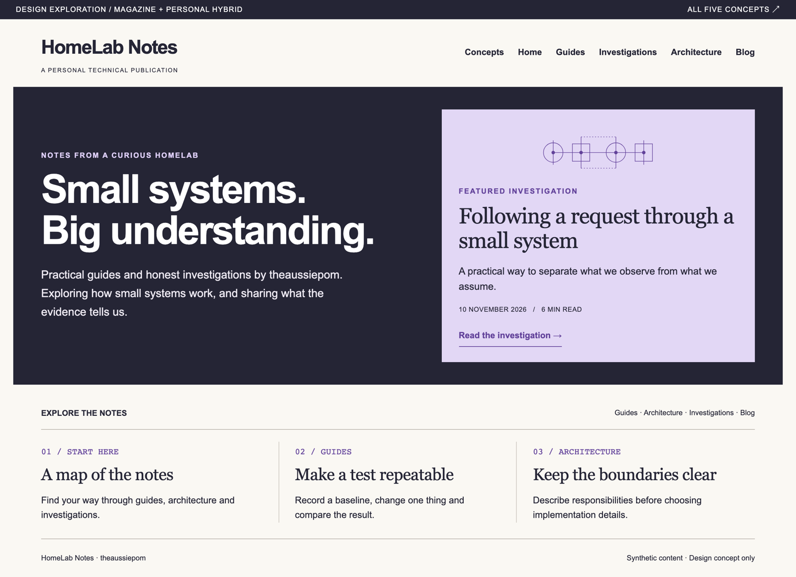
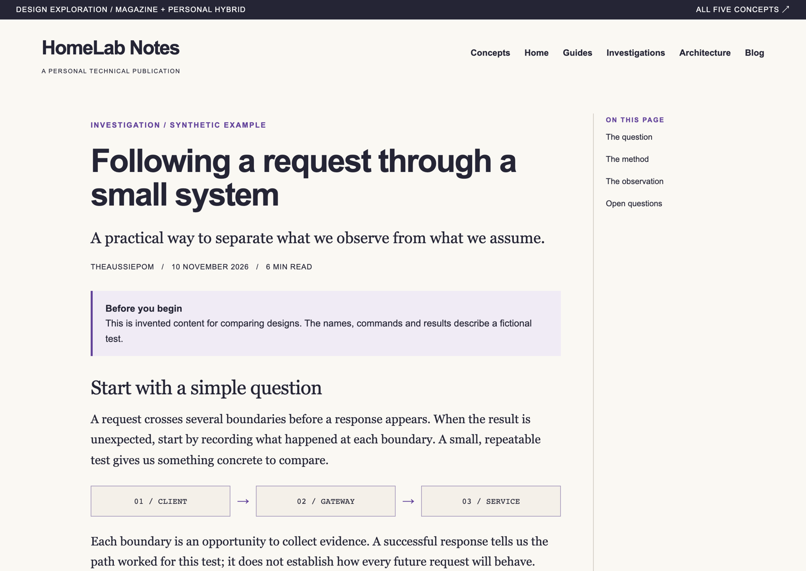

# The Aussie Pom: visual style and layout guide

Version 2.0 | 12 November 2026 | The Aussie Pom identity with the approved hybrid layout

## 1. Direction and authority

The chosen direction combines the Technical magazine's confident homepage with the Quiet personal publication's warm, comfortable reading experience. Use this guide for future layout, typography, colour and component work. This Markdown is the maintained specification. The PDF edition was retired on 11 November 2026.

These rules define the shared visual language and the required adaptations to the native publishing shell. Bring the implementation into conformance when it differs; record verification and deployment status in the acceptance record. Reference images use synthetic content. Article wording, diagrams and dates in them are examples, not editorial requirements.

The author-reviewed article **From a NAS VM to Proxmox: five versions of my homelab** is the approved benchmark for reading flow, visual pacing, image placement and contents navigation. Follow the [voice guide](../editorial/voice.md) for its conversational storytelling. The current rules below are authoritative for article layout.

Keep the bold sans-serif masthead, dark opening panel and lilac featured article. Use warm paper surfaces and serif text for article summaries and extended reading. Carry purple accents consistently from discovery into the article. The homepage may be expressive; the article should give the text room to breathe.

Use the supplied portrait identity according to the [brand identity guide](branding.md). The approved portrait with eyes and outlined wordmark form the shared masthead. Its face stays black on lilac in both themes; only the lettering changes colour. Reserve the eyeless micro portrait for favicons and home-screen icons. The brand suite preserves this palette and the typography roles below.



The reference image illustrates typography, palette and visual pacing. Follow the publication name, shared sidebar and responsive rules specified below for the current composition. Dark mode is specified below. Editorial templates apply this guide alongside the voice and publishing requirements.

<!-- pagebreak -->

## 2. Typography

Use local system fonts. No external font service or font download is required. Test fallback rendering because font availability and metrics vary by operating system.

Logo lettering is supplied as outlined Liberation Sans Bold artwork. It is an asset, not a new website font dependency. The source font and its licence remain with the archived editing files.

Sharing images use that bundled bold font for deterministic rendering. Published article cards follow the [brand identity](branding.md) and [URL preview](../sharing-previews.md) specifications: warm paper, dominant title, a small category label and an approved portrait signature. Titles must fit in full without clipping or silent truncation. This image-generation font does not change the website's typography roles below.

| Role                                              | Font stack                                                           | Weight                                    |
| ------------------------------------------------- | -------------------------------------------------------------------- | ----------------------------------------- |
| Brand, display headings, navigation, labels       | Arial, Helvetica, sans-serif                                         | 700 for emphasis; 400 for supporting text |
| Article body, lede, section headings, card titles | Georgia, 'Times New Roman', serif                                    | 400; 700 for inline emphasis              |
| Code, commands, identifiers                       | ui-monospace, SFMono-Regular, Consolas, 'Liberation Mono', monospace | 400                                       |

### Type specimens

> Display / Arial: Small systems. Big understanding.

> Reading / Georgia: A practical way to understand the system.

> Code / monospace: curl --head https://service.example.test

Use genuine available weights. Arial commonly provides regular and bold; use 700 rather than relying on a synthetic 800 weight. Keep the expressive homepage headline in sans-serif and the featured article's title in serif.

| Element                | Desktop size / line height | Mobile size / line height            |
| ---------------------- | -------------------------- | ------------------------------------ |
| Homepage headline      | 60px / 1.03                | 36-45px / 1.03                       |
| Article title          | 48px / 1.08                | 32px / 1.08                          |
| Featured article title | 33px / 1.15                | 29px / 1.15                          |
| Article lede           | 23px / 1.45                | 22px / 1.50                          |
| Article body           | 18px / 1.70                | 18px / 1.70                          |
| Article H2 / H3        | 29px / 1.25; 23px / 1.30   | 29px / native heading rhythm; 23px   |
| Discovery card title   | 25px / 1.20                | 25px / 1.20                          |
| UI and navigation      | 14-16px / 1.50             | 14-16px / 1.50                       |
| Labels and metadata    | 12px / 1.50 minimum        | 12px / 1.50 minimum                  |
| Code / table text      | 14px / 1.70; 16px / 1.50   | Same sizes; contain overflow locally |

Implement sizes in rem, based on the user's default font size; do not lock the root font size. Use fluid sizing between these anchors. Guides, architecture articles and investigations display their description as a lede. Blog posts retain their native metadata and article body. Preserve the native heading spacing and code line-height where the framework supplies them. Keep body text left-aligned and avoid justified columns. Target 60-75 characters per line, with the article width capped at 700px.

Use at most -0.04em tracking for display headings and -0.02em for serif titles. Body text uses normal tracking. Short uppercase labels may use 0.10em tracking; never use uppercase for paragraphs. Give paragraphs 1em separation and H2 sections about 2em above / 0.6em below. Essential labels and commands must remain legible at 200% zoom.

<!-- pagebreak -->

## 3. Colour system

Use semantic roles rather than scattering literal colours through component CSS. The light theme uses warm paper and a dark homepage panel. The dark theme uses an ink reading surface and muted violet panels. The hero retains its fixed dark surface in both modes.

| Token               | Value   | Intended use                               |
| ------------------- | ------- | ------------------------------------------ |
| --hl-paper          | #FAF8F3 | Page and article background                |
| --hl-ink            | #252535 | Primary text (hero uses fixed ink)         |
| --hl-accent         | #62429A | Links, labels, active navigation and focus |
| --hl-feature        | #E2D7F5 | Featured article background                |
| --hl-on-dark        | #FFFFFF | Display headings on dark surfaces          |
| --hl-inverse-body   | #EEEAF3 | Body text on dark surfaces                 |
| --hl-inverse-accent | #DFD0FA | Links and labels on dark surfaces          |
| --hl-callout        | #F0EBF5 | Informational callout background           |
| --hl-rule           | #BEB9B1 | Decorative section separators              |
| --hl-rule-soft      | #D0CBC3 | Decorative column dividers                 |
| --hl-diagram-paper  | #F4F0E9 | Diagram node background                    |

Use ink for body text and the framework's contrast-tested grey scale for supporting UI; establish hierarchy with size, weight and spacing instead of low-opacity text. The two rule colours are decorative only. Use the accent or ink for a boundary that is necessary to recognise an input, button or selected state.

### Measured text contrast

These ratios are calculated from the listed solid sRGB colours, rounded to two decimals. They validate colour pairs, not the accessibility of the finished website. Require at least 4.5:1 for normal text and 3:1 for essential control boundaries and indicators.

| Pair                | Contrast |
| ------------------- | -------- |
| Ink on paper        | 14.19:1  |
| Accent on paper     | 7.16:1   |
| Ink on lilac        | 10.95:1  |
| Accent on lilac     | 5.52:1   |
| White on ink        | 15.06:1  |
| Inverse body on ink | 12.69:1  |
| Accent on callout   | 6.48:1   |

Underline links within prose. Pair status colours with text or an icon and a label. Use a 3px accent focus outline with a 3px offset on light surfaces, and the inverse accent on dark surfaces. Verify the actual adjacent colours during implementation. Success, warning and error palettes are not approved here; preserve accessible framework treatments until separately reviewed.

<!-- pagebreak -->

## Dark-mode reference

The following semantic overrides belong to the same hybrid design. Keep display hierarchy, spacing and typography identical across modes. Do not use a blanket colour inversion.

| Token          | Value   | Intended use                     |
| -------------- | ------- | -------------------------------- |
| --hl-paper     | #1B1B27 | Page and article background      |
| --hl-ink       | #F1EEE8 | Primary reading text             |
| --hl-accent    | #CBB5F1 | Links, active controls and focus |
| --hl-feature   | #332B46 | Featured article panel           |
| --hl-callout   | #2A2539 | Notes, diagrams and inline code  |
| --hl-rule      | #615A6D | Decorative section separators    |
| --hl-rule-soft | #484252 | Decorative dividers              |

The fixed hero remains #252535 with white headings, #EEEAF3 body text and #DFD0FA labels. The feature card uses the theme-dependent panel, text and accent roles. Native search, sidebar, contents, menus and code blocks follow the same selected theme. Warning, danger and tip treatments retain their native semantic colours.

Light, Dark and Auto must remain usable on desktop and mobile. In Auto, changing the operating system preference updates the page. Explicit choices persist through navigation and reloads. Keep focus indicators visible on both page and panel surfaces. Inspect syntax highlighting and controls after framework updates.

<!-- pagebreak -->

## 4. Homepage layout and responsive rules

### Desktop: 1100px and wider

Use a centred homepage content wrapper with a maximum width of 1160px in the space beside the shared 240px sidebar. Native Starlight outer gutters surround it; the hero adds 42px internal side padding when there is enough space. The header is 80px tall. Place the masthead at left, native search in the middle and theme/social controls at right. Order profile controls GitHub, LinkedIn, RSS, with descriptive accessible names, hover labels and 44px interaction targets. Retain the native separator and mobile-menu placement. Use the supplied approved portrait masthead with the publication name, The Aussie Pom, and no subtitle. Its light/dark lettering follows the native theme while the black portrait and lilac circle stay consistent. Scale the 514 × 104 artwork to at most 272px wide; at 448px and narrower, use the 653 × 208 compact lockup at 160px wide. Both fit the header content height and retain one accessible home-link name. See the [brand guide](branding.md) for asset paths and usage. Use the sidebar for Home, About Ben and direct links to published stories. Keep About separate from the Stories group. Keep editorial samples as drafts. The homepage has no separate topic navigation or section landing-page cards.

The hero spans the wrapper's full width. Above 960px of available container width, use two columns with a 1.18:1 ratio, a 46px gap and 34px vertical padding. Stack them when the sidebar leaves less space. Align the introduction and featured article near their vertical centres. The left column contains the supporting line “Software, systems and curiosity in action.” in readable sentence case, the unchanged headline “There’s always one more thing to build.”, a concise personal introduction and an About Ben link. Let the supporting line wrap naturally; keep it out of the shared masthead. Limit the introduction to about 455px. Avoid fixed heights or manual line breaks that fail at intermediate widths.

The lilac feature uses 24-28px padding, one representative diagram or image, a serif article title, a short summary, metadata and a clear reading link. Its image should support the subject. Abstract graphics in the reference are placeholders, not a permanent brand asset.

Below the hero, show the other published articles under an understated Keep exploring label. List them by publication date, newest first, then alphabetically by title when dates match. Link their actual titles and show their summaries. Use 24-32px gaps, serif titles and simple rows or columns. Omit the section when there are no other published articles. Drafts receive no homepage card or public navigation link.

### Tablet: 701-1099px

Use the native outer gutters and 28px internal hero padding. The shared sidebar changes to the native labelled Menu control below 800px on the homepage and article pages. Theme and social controls remain accessible through the mobile menu. Stack the hero by default; use two columns only when the available container width supports them. Article rows may use two columns. Do not shrink text to preserve a desktop composition.

### Mobile: up to 700px

Use native outer gutters and 22px internal hero side padding. Stack the hero and article rows. Use 28px hero vertical padding, 20px feature padding and about 26px between the introduction and feature. The homepage uses the same labelled Menu button, sidebar and 80px masthead as article pages. Keep search visible and theme selection available in the menu. Do not add a second homepage navigation row.

### Shared spacing and geometry

Use a 4px spacing scale: 4, 8, 12, 16, 20, 24, 28, 32, 40, 48 and 64px. The approved 22px gutter, 34px hero padding and 46px hero gap are documented composition exceptions. Use square or subtly rounded corners, 0-4px. Use thin rules and colour blocks for structure; shadows are not the default. Prefer content-driven heights.

<!-- pagebreak -->

## 5. Article layout



This original prototype predates the approved left-hand article contents. Its typography and colour remain useful references; use the current navigation and pacing rules below for article composition.

Cap the reading column at 700px inside Starlight's native article shell. For a long article, use the approved reading-focused navigation: from 800px, put the compact **On this page** contents list in the 240px left sidebar, with **Browse the site** collapsed beneath it. Show the current section clearly, keep the article centred in the remaining area, and omit a duplicate right-hand contents column. Readers should be able to scan the story without a large contents box pushing the opening down the page.

Below 800px, preserve the native **On this page** disclosure and labelled **Menu** control. Contents links must reach the correct heading, preserve visible focus and leave the reading area usable after selection. Keep search, theme selection and site navigation accessible. Test either side of the 800px breakpoint as well as the normal mobile and desktop widths. Section landing pages retain their normal site navigation.

Apply this navigation consistently to guides, architecture articles, investigations and blog posts with article contents. Use the shared article components so a newly written article receives the layout automatically. The homepage exposes the shared story navigation directly in its sidebar. Article pages retain their contents list with the same story navigation under Browse the site. Archive navigation retains its documented treatment.

For guides, architecture articles and investigations, use the native title followed by a description lede and a compact metadata row: type, author, publication date, optional update date, estimated reading time and topics. A local draft notice appears after the title when needed. Blog pages retain the plugin's native author, date, reading metrics and tags; do not duplicate that metadata. Landing pages have no article introduction. Use a single H1 followed by a logical heading hierarchy. Keep paragraphs and diagrams in the reading column. Wide tables or code may scroll within their own container, never force horizontal scrolling of the page.

Use sans-serif for the title, metadata and navigation; serif for the lede, body and section headings. The desktop title is 48px, the body is 18px with 1.7 line height. Mobile retains the body size. The table of contents may be sticky if it stays inside the viewport and does not obscure focus or headings.

The reference screenshot is a top-of-article excerpt. Real articles must preserve useful navigation through the full page, including previous/next or related content where appropriate. Long titles, multiple authors, absent imagery and long code lines must all fit without changing the design's basic rules.

### Pacing the page

Let the title, lede and compact metadata lead into the opening paragraphs. The lede should invite the reader into the subject; it is not an extra technical abstract to work through. Establish the human context before presenting a large diagram or inventory. The reading column, paragraph spacing and clear section headings should give a story room without decorative interruptions or a callout around every point.

Place each visual where the reader has enough context to understand it. In the approved article, the tablet image follows the real home-automation example; the five-stage diagram follows the first setup and the reason for changing it. The storage comparison appears when the NAS changes jobs, and the startup chain appears with the dependency explanation. These placements demonstrate the principle, not a required image count or a fixed article outline.

Keep figures within the reading column, normally with 2rem vertical separation. Diagrams use the shared semantic colours, restrained rules, sans-serif labels and readable text rather than flattened screenshots of small type. Let comparisons and dependency chains stack on narrow screens. Explain what a connection or transition means, not only which machines exist. A graphic should carry its part of the explanation rather than repeat a nearby paragraph word for word.

Use a genuine, public-safe photograph or screenshot when it helps readers picture the result. Give it meaningful alternative text, reserved dimensions, a short caption beneath it and a full-size link when the detail warrants one. The reference tablet caption uses 14px sans-serif text with a 1.6 line height. Do not manufacture a photograph of the author's home or imply that a configured behaviour has been observed live when it has not.

Keep the ending in the same reading flow. Let the author finish the thought and make a useful connection to what follows. Place the shared author bio after the story when a profile is available for the credited author. Use the heading “About Ben Dennis”, a centrally maintained 40–60 word biography, a link to the full About page and separate GitHub and LinkedIn links with clear labels. Use a compact card with a sans-serif heading, body typography and the theme's callout surface. When the author supplies a portrait, place a small square photo beside the bio on desktop. On narrow screens, put it beside the heading and let the paragraphs use the full card width. Place comments below the bio, followed by the existing footer navigation. Do not insert a large promotional panel between the final paragraphs or duplicate the article contents at the bottom.

<!-- pagebreak -->

## 6. Components and interaction

| Component             | Required treatment                                                                                                                                                                                                             |
| --------------------- | ------------------------------------------------------------------------------------------------------------------------------------------------------------------------------------------------------------------------------ |
| Links                 | Accent on light surfaces; inverse accent on dark. Underline prose links. Hover may strengthen the underline; focus must remain explicit.                                                                                       |
| Navigation            | Clear active item using text weight plus an indicator. Preserve visible labels and access to search. Do not rely on colour alone.                                                                                              |
| Mobile menu           | Labelled button with expanded state. Keyboard operable; keep focus order logical. Restore focus on close when using a modal drawer.                                                                                            |
| Featured article      | Lilac surface, serif title, concise summary and one primary reading action. Avoid nested interactive targets.                                                                                                                  |
| Informational callout | Callout surface, 3px accent left edge, clear text label, 16px body and 16-20px padding. Do not use this style for every severity.                                                                                              |
| Code block            | Native syntax colours, 14px monospace and framework line height. In light mode, use the callout-tinted code surface, lilac title bar, purple title and a purple-toned border. Preserve command whitespace and local scrolling. |
| Inline code           | Monospace, restrained tinted surface, enough padding to distinguish it without breaking line rhythm.                                                                                                                           |
| Table                 | 16px text, strong column headers, generous cell padding and light row rules. Associate headers semantically. Scroll only the table when needed.                                                                                |
| Diagram               | Callout-tinted nodes, labelled connections and readable text. Provide a meaningful text alternative. Distinguish states with shape or labels as well as colour.                                                                |
| Search                | Retain Pagefind/Starlight search behaviour, keyboard access, result feedback and empty states. Style without replacing its semantics.                                                                                          |

Size primary touch targets to at least 44px by 44px where practical, including Menu, search and copy buttons. Avoid hover-only information. Respect reduced-motion preferences; transitions should be brief and functional, with no automatic animation required for reading.

Preserve framework code-copy controls and accessible labels. Syntax-highlighting colours require their own contrast check against the code background. Do not wrap copyable shell commands in ways that alter their content; the prototype's display wrapping is not a production requirement.

Light-mode code panels use `--hl-callout` (#F0EBF5), with `--hl-feature` (#E2D7F5) for file and terminal headers. Use the accent for file-title text, and mix 60% accent with 40% paper for the thin frame border. Apply these through Expressive Code's shared surface and frame variables so titled blocks, untitled blocks and copy controls belong to the same panel. Retain the existing dark-mode code treatment. Code backgrounds are flat, without shadows or decorative left stripes.

Use authentic article diagrams, photographs or illustrations only when they contribute to understanding. Keep imagery responsive and reserve its layout space to avoid jumps. Sanitise all technical examples and screenshots under the existing editorial policy. No private infrastructure detail belongs in design fixtures.

Published articles use the embedded Giscus comment area with a clear heading, a short invitation and a link to GitHub Discussions. Reading does not require sign-in; posting does. Match the selected light/dark mode, retain the GitHub alternative if the widget is blocked, and exclude comments from the article contents and search index. Local drafts show a publication notice instead of connecting to live comments. See [comments and readership](../comments-and-analytics.md).

<!-- pagebreak -->

## 7. Astro and Starlight implementation

Apply the guide through shared tokens, scoped styles and the smallest necessary components. Keep Markdown/MDX content, Starlight navigation, headings, search, code rendering, RSS, sitemap and starlight-blog integration intact. The static publishing architecture and deployment pipeline remain authoritative.

Start with theme tokens and typography, then the custom homepage and shared article treatment. Map semantic colours to the installed Starlight version's supported theme variables. Use documented component extension points; verify current APIs before implementation. Scope homepage composition separately from article rules so the dark hero does not leak into documentation pages.

### Core token example

```css
:root {
  --hl-paper: #faf8f3;
  --hl-ink: #252535;
  --hl-accent: #62429a;
  --hl-feature: #e2d7f5;
  --hl-callout: #f0ebf5;
  --hl-font-ui: Arial, Helvetica, sans-serif;
  --hl-font-reading: Georgia, 'Times New Roman', serif;
  --hl-font-code:
    ui-monospace, SFMono-Regular, Consolas, 'Liberation Mono', monospace;
  --hl-reading-size: 1.125rem;
  --hl-reading-line-height: 1.7;
}
```

This abbreviated light palette illustrates the roles. The authoritative mappings and both palettes are in `src/styles/hybrid.css`; its base tokens are dark and its `[data-theme="light"]` override is light. Native Starlight controls provide Light, Dark and Auto, persist an explicit choice, and follow system preference in Auto. No additional theme storage or custom switching script is required.

`HomeHero.astro` supplies the homepage and falls back to the native hero elsewhere. `SiteTitle.astro` supplies the masthead. `ArticleTitle.astro` preserves the native title, adds the article lede and metadata, and labels local drafts. Keep its metadata at 14px with wrapping rows. Show estimated reading time as whole minutes rounded up, for example “7 min read”. Calculate it automatically from article text and code at 200 words per minute, with a minimum of one minute. Navigation, the author bio, comments, link destinations and source-only authoring notes are excluded. The estimate is a guide; diagrams and code can take longer to work through.

Use the shared `ArticleSidebar.astro` and `ArticlePageSidebar.astro` for article contents and site browsing. Use native HTML/SVG diagrams and responsive image components with captions to meet the visual rules above. `ArticleFooter.astro` adds the shared author bio and comments while preserving the framework footer. Keep layout decisions in components and shared styles, with article prose and visual placement in Markdown/MDX. Do not require authors to select a route-specific layout to obtain the approved reading experience.

Use the [editorial workflow and templates](../editorial/workflow.md) for article structure. They use native Starlight notes and steps, Markdown tables and code. The Australian English UI dictionary supplies blog labels because plugin `en` strings do not fall back to `en-AU`; maintain it when blog controls change.

### Implementation acceptance

- Compare the rendered homepage and article with the approved references at 1200px and 390px.
- Check 320px, 700px, 768px, 1024px and 1440px widths, long titles and 200% zoom.
- Verify menu, search, article anchors, focus order, visible focus, copy controls and theme switching with keyboard input.
- Check actual text, control and syntax colours; run automated accessibility checks and inspect the result manually.
- Check article prose, lists, tables, code, diagrams, callouts and image captions with realistic synthetic content.
- Run the repository's required validation and security checks before integration. Verify preview rendering before production deployment.

<!-- pagebreak -->

## 8. Maintenance and acceptance

### Required verification

Validate formatting, lint, types, production builds, generated links, draft exclusions and browser behaviour. Check both palettes, 320-1440px layouts, article contents, mobile site browsing, search, theme persistence, system preference, enlarged text, RSS and sitemap. Inspect the result visually as well as running automated checks. Record what passed, where it was tested and any unresolved gaps in the [acceptance record](../acceptance.md).

Automated checks do not replace a complete accessibility review, and root-text enlargement does not establish browser-zoom equivalence. State actual Firefox, Safari and screen-reader coverage in the acceptance record. Rendering tests establish presentation, not the truth of an article's technical claims.

### Keeping the specification current

Maintain this Markdown directly, with its version and date. There is no PDF edition to regenerate. Update reference images when an approved visual change makes them stale, using synthetic, public-safe content. Keep historical references distinguishable from the current article rules. Do not change the approved article merely to make it match an outdated screenshot or specification.

Use pull requests for integration and follow the existing validation gates. Changes to typography roles, primary palette, homepage composition or article reading width require an explicit design decision. Routine implementation adjustments may follow the documented responsive and accessibility rules.

### Design review questions

- Does the homepage retain the confidence and visual character of option 04?
- Does the article preserve the warmth and reading comfort of option 05?
- Can readers find guides, investigations, architecture and blog content quickly?
- Does the same hierarchy survive a narrow screen, long title and enlarged text?
- Are framework capabilities and public-content boundaries preserved?

### Document map

- [Repository README](../../README.md)
- [Architecture decision](../decisions/0001-static-publishing.md)
- [Editorial workflow and templates](../editorial/workflow.md)
- [Editorial sanitisation policy](../editorial/sanitisation.md)
- [Foundation acceptance evidence](../acceptance.md)
